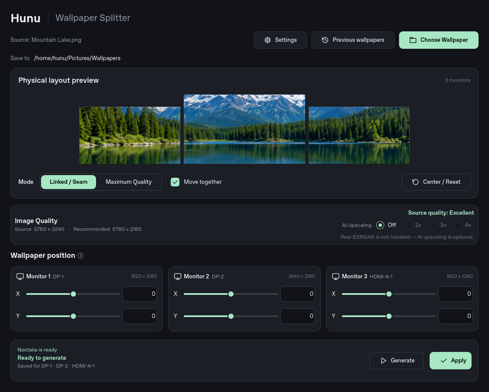
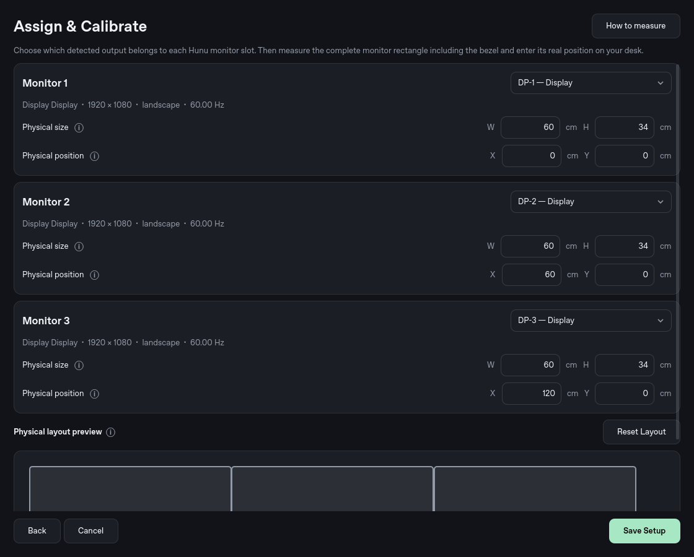
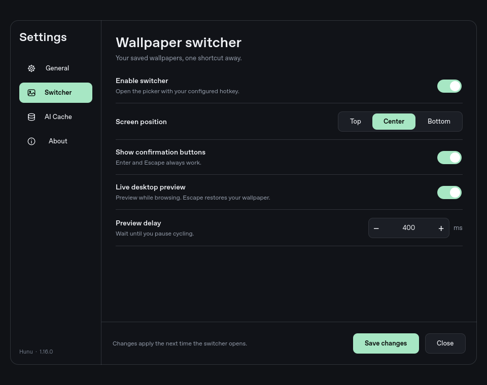

# Hunu Wallpaper Splitter

**Hunu Wallpaper Splitter** is a Hyprland + Quickshell application for creating
coordinated wallpapers across **one to three monitors**.

Instead of assuming that every display has the same size, orientation, or pixel
density, Hunu Wallpaper Splitter can use each monitor's **real physical
dimensions and placement** to build a composition that visually continues
across the displays.

## Changes in v1.17.0

- Build a native Rust startup helper during installation. It replaces the Python
  settings check before Qt launches and the Python socket bridge afterward.
  The transaction controller, strict layout revalidation, thumbnail builder,
  and Apply/rollback logic remain in Python.
- Use the native helper automatically after installation. Set
  `HUNU_SWITCHER_NATIVE=0` to compare against Python startup helpers; parallel
  startup remains the default in both modes. Trace output identifies the helper.
- Require Rust/Cargo 1.85+ and a C linker at install time. The installer runs an
  optimized build with the committed Cargo lockfile before changing installed
  files. The first build downloads the locked crates; later builds reuse them.
- Preserve the existing settings format and disabled-switcher behavior. Cover
  native transport cleanup on commit, cancel, disconnect, startup interruption,
  launcher termination, and Qt startup failure.

## Changes in v1.16.9

- Make parallel controller/Qt startup the default for `switcher.sh`. Existing
  hotkeys benefit automatically; no environment flag or resident service is needed.
- Keep sequential startup available with `HUNU_SWITCHER_PARALLEL=0` for
  troubleshooting. The separate initial-selection waiting experiment stays off.
- Verify default-path process cleanup on commit, cancel, disconnection, launcher
  termination, startup interruption, and failure before connection.

## Changes in v1.16.8

- Fix normal startup accidentally selecting the parallel socket bridge when
  Quickshell returns `undefined` for an unset environment variable.
- Require an explicit parallel-startup flag and a nonempty absolute socket
  path before using the bridge. Clear inherited socket values on normal launch.
- Cover actual unset-variable behavior, invalid and stale socket values, and
  explicit parallel selection in native QML regression checks.

## Changes in v1.16.7

- Add an opt-in parallel startup trial: `HUNU_SWITCHER_PARALLEL=1` starts the
  controller alongside Qt. It prepares the library and rollback snapshot while
  Qt initializes, then delivers buffered results over a private local socket.
- Keep normal startup as the default. Compare with the picker closed between
  runs, without enabling the separate initial-selection experiment:

  ```bash
  HUNU_SWITCHER_TRACE=1 ~/.config/hunu-wallpaper/switcher.sh
  HUNU_SWITCHER_PARALLEL=1 HUNU_SWITCHER_TRACE=1 ~/.config/hunu-wallpaper/switcher.sh
  ```

- The launcher owns both processes and cleans up its private socket on exit.
  The short-lived transport exits with the picker; disconnecting restores any
  uncommitted wallpaper. No background service is installed.
- Include lifecycle tests for commit, cancel, transport disconnect, launcher
  termination, startup interruption, and Qt failure before connection.

## Changes in v1.16.6

- Add an opt-in startup experiment: set `HUNU_SWITCHER_WAIT_INITIAL=1` to wait up
  to 60 ms for the current wallpaper before decoding the first preview triplet.
  A fast snapshot selects the correct neighbors immediately; slow IPC falls
  back to the remembered selection. Escape restoration stays unchanged.
- Keep immediate preview loading as the default: an offscreen Qt comparison
  with a simulated 20 ms snapshot found the experimental path slower. Compare
  both on your desktop with the picker closed between runs:

  ```bash
  HUNU_SWITCHER_TRACE=1 ~/.config/hunu-wallpaper/switcher.sh
  HUNU_SWITCHER_WAIT_INITIAL=1 HUNU_SWITCHER_TRACE=1 ~/.config/hunu-wallpaper/switcher.sh
  ```

  Repeat each command a few times and compare `first-view-ready` timings and
  the initial `preview-ready-*` indices. `preview-decoding-started` now marks
  when the first loads begin. No resident process or new setting is added.

## Changes in v1.16.5

- Reuse persistent switcher thumbnails bounded to 1000×700 pixels, including
  older sets whose only preview is a full-resolution monitor crop. Preserve
  the original aspect ratio and apply the original full-resolution files.
- Build missing thumbnails in a low-priority, single-converter background helper
  after the first view appears. First use continues with the existing previews;
  subsequent openings use cached JPEGs. Closing the picker stops conversion and
  removes partial files. There is no persistent background service.
- Invalidate thumbnails when their source changes, publish completed files
  atomically, and remove obsolete cache files after a completed warmup.
- Startup tracing now reports thumbnail hits/misses and
  `thumbnail-warmup-finished`. Leave the first picker open until warmup finishes,
  then close and reopen it to compare cached startup timing.

## Changes in v1.16.4

- Replace per-preview Canvas shadow blurs with lightweight scene-graph shadow
  layers. Keep rounded images, borders, and the complete first appearance while
  avoiding expensive software blur work on the GUI thread.
- Discard the unused initial triplet when the rollback snapshot updates the
  selected wallpaper before reveal. Keep normal cycling atomic after reveal.
- Add individual preview-painted timing events to the existing startup trace.

## Changes in v1.16.3

- Load switcher preview pixels directly into one Canvas, removing the hidden
  Image loader. Read and cache preview geometry from PNG/JPEG headers instead.
- Preserve rounded corners, outgoing images during replacement loads, bounded
  neighbor caching, and the complete first view. Invalid source previews fall
  back to a monitor crop.
- Add optional startup timing. Close the picker, then run:

  ```bash
  HUNU_SWITCHER_TRACE=1 ~/.config/hunu-wallpaper/switcher.sh
  ```

  `HUNU_SWITCHER` lines report launcher/QML startup, configuration, monitor
  detection, library-index hit/miss, catalog delivery, individual previews,
  first-view readiness, and rollback snapshot completion. `elapsedMs` on QML
  events and `launchElapsedMs` on controller events count from the launcher;
  controller `elapsedMs` measures its own work. Normal launches stay quiet.

## Changes in v1.16.2

- Reveal switcher images and controls together after the visible previews have
  painted, avoiding a partially assembled first view.
- Decode the visible triplet first and defer extra neighbor prefetching until it
  appears. Keep subsequent cycling and image reuse unchanged.
- Use Basic Qt controls and skip the desktop platform-theme plugin for the
  self-drawn switcher overlay, avoiding unnecessary portal/theme initialization.

## Changes in v1.16.1

- Show the switcher before the wallpaper rollback snapshot finishes. Live desktop
  previews wait until restoration is safe; Enter and Escape keep working.
- Query current Noctalia wallpapers concurrently, reuse loaded monitor settings,
  and cache library metadata and image dimensions until saved files change.
- Revalidate selected wallpapers before applying them, including cached sets.

## Changes in v1.16.0

- Refresh the application with a charcoal palette, mint primary actions, clear
  typography, and a shared set of rounded controls. Optional external theme
  palettes continue to work.
- Give the workspace a larger preview canvas, compact composition controls,
  cleaner quality/position sections, and a persistent action bar.
- Redesign Settings with a navigation rail, divided form rows, switches, segmented
  position selection, and a fixed Save changes / Close footer.
- Apply the same control styling to monitor setup, the measurement guide, and
  Previous wallpapers. Keep generation and backend behavior unchanged.
- Include the carousel caching fix: prepared assets move between positions without
  re-decoding; neighboring images update as one consistent triplet.

## Changes in v1.15.5

- Reuse prepared image items across carousel positions instead of reloading each
  fixed slot when cycling. Center/side previews share one bounded decode size.
- Prepare nearby images ahead of navigation and update the displayed triplet
  together. Cold loads keep the outgoing triplet intact and skip superseded requests.
- Keep the memory window bounded to five requested previews plus the outgoing
  triplet. Enter waits for the highlighted selection to be displayed before keeping it.

## Changes in v1.15.4

- Remove preview slide and hover animations. Loaded replacements appear directly,
  with no animation timer or movement.
- Retain outgoing previews while images load, rounded clipping, borders, and
  existing live-wallpaper preview delay preferences.

## Changes in v1.15.3

- Keep all outgoing preview images and frame dimensions visible while replacements
  decode, instead of collapsing/clearing them during asynchronous loading.
- Start the slide after the new image has actually painted, so image loading does
  not consume the animation. Interrupted loads keep the last usable image.

## Changes in v1.15.2

- Fix square image corners extending outside the rounded border: image clipping
  and border drawing now share one rounded path, in both GPU/software rendering.
- Add a subtle 160 ms directional slide when the selected image changes.
  Rapid navigation restarts the motion for the latest selection without queueing
  animations or changing the live-preview delay/rollback behavior.

## Changes in v1.15.1

- Round the actual image edges in all three carousel previews, including portrait
  sources, without cropping the image or framing its transparent letterbox area.
- Add subtle borders and soft shadows; highlight the selected preview and brighten
  neighboring previews on hover. The surrounding overlay stays transparent.
  Rounded masking and shadows use Qt Quick's GPU effects; software rendering
  falls back to plain images with borders.

## Changes in v1.15.0

- Add Settings → Switcher with enable/disable, top/center/bottom position,
  live desktop preview, preview delay, and apply/cancel button visibility.
- Put navigation arrows on their own row above apply/cancel. Hide the second row
  for keyboard-only confirmation; Enter and Escape always remain active.
- Save per-installation preferences separately from monitor calibration and
  preserve them across reinstalls. Existing installations retain the current
  behavior by default.

## Changes in v1.14.3

- Remove visible titles, captions, counters, and helper text from the switcher.
- Add larger 64-pixel icon controls: previous, next, checkmark to keep, and X to
  cancel/restore. Arrow keys, Enter, and Escape retain their existing actions.
- Use a spinner for progress and icons for errors/empty results. Controls retain
  accessible names; error details remain available through accessibility and logs.

## Changes in v1.14.2

- Replace the bottom thumbnail strip with a three-image carousel: the current
  image is centered, with smaller previous/next previews at its sides.
- Click a side image to cycle. Only immediate neighbors are loaded; one-set and
  two-set libraries avoid showing duplicate neighbors.
- Keyboard navigation, live preview, Enter to keep, and Escape to restore are
  unchanged.

## Changes in v1.14.1

- Wait for 400 ms of quiet navigation before sending a desktop preview. New
  selections replace the pending one; completing an older request cannot bypass
  the quiet period. Enter and Escape still take priority.
- Revalidate only the selected set during preview, avoiding a full-library rescan.
- Noctalia may still finish a transition already accepted; Hunu cannot retract it.

## Changes in v1.14.0

- Center switcher titles, captions, status text, and navigation controls.
- Add live desktop previews for native Noctalia installations: browsing applies
  the highlighted compatible set, Enter keeps it, and Escape restores the actual
  per-output wallpaper paths captured when opening the picker.
- Debounce navigation and serialize previews. Temporary previews do not update
  Hunu's remembered selection, and other Apply operations are blocked while the
  picker session is active.
- Fall back to confirmation-only browsing when the backend cannot report readable
  current wallpaper paths. Noctalia's native `msg` interface is currently required
  for live preview.

## Changes in v1.13.2

- Show single images floating on a transparent switcher overlay, without the
  enclosing card, dimmed backdrop, or monitor outlines.
- Save a full-source JPEG preview (up to 1600×1000) beside newly generated sets.
  The original image remains unchanged and is not copied at full resolution.
- Older sets use a single monitor crop as a clearly labelled fallback. Regenerate
  a set to give it a full-source preview.

## Changes in v1.13.1

- Show the switcher as a centered layer-shell overlay on the focused monitor,
  above normal windows and fullscreen applications, with a dimmed backdrop.
- Escape or clicking outside the picker cancels. No separate tiled or floating
  application window is created, and no workspace space is reserved.

## Changes in v1.13.0

- Added a separate visual saved-wallpaper switcher, launched on demand without
  loading the full editor or leaving a background service running.
- Preview complete monitor compositions with Left/Right, confirm with Enter,
  and cancel with Escape. Repeating the hotkey advances the existing picker.
- Filter sets by exact active output assignments and crop pixel dimensions,
  including rotation; recheck compatibility immediately before Apply.
- Remember successful applications from both the editor and switcher. Serialize
  wallpaper Apply operations to prevent overlapping changes.

## Changes in v1.12.3

- Handle the main window's close signal directly so compositor close shortcuts
  such as Hyprland's Super+Q quit Hunu without depending on the global
  last-window notification. Live confirmation of this fix is pending.

## Changes in v1.12.2

- Closing the last Hunu window now quits the application instead of leaving an
  invisible Quickshell process running.
- Desktop and manual launches use a per-installation lock and Quickshell's
  duplicate-instance check. Repeated launches exit while Hunu is running;
  separate named test installations remain independent.
- Already-running instances from older versions must be closed once after updating.

## Changes in v1.12.1

- Fixed Noctalia support for native installations using
  `noctalia msg wallpaper-set OUTPUT PATH`.
- Native readiness checks use the read-only `noctalia msg wallpaper-get` command.
- Retained the Quickshell adapter for older installations without `noctalia`.

## Changes in v1.12.0

- Added Noctalia Shell as an Apply backend in Settings → General.
- Apply generated and saved wallpaper sets to their assigned outputs through
  Noctalia wallpaper IPC.
- Added live Noctalia endpoint checks, saved backend selection, and Apply error
  reporting with a timeout.
- Added six backend contract tests covering readiness, multi-output commands,
  paths with spaces, validation, failures, and configuration persistence.

Noctalia requires a running `noctalia-shell` Quickshell configuration with its
wallpaper service enabled. Backend contract tests pass; live Noctalia desktop
integration has not yet been validated.

## Preview



Create and preview coordinated wallpapers using the physical arrangement of your monitors.

## Features

- Supports **1–3 monitors**
- Automatically detects connected Hyprland outputs
- Assign any detected output to Monitor 1, 2, or 3
- Configure physical monitor width, height, X position, and Y position in cm
- Supports landscape, portrait, mixed-resolution, and offset monitor layouts
- **Linked / Seam** mode for one physical composition across displays
- **Maximum Quality** mode for independent source crops
- Physical-layout preview
- Wallpaper positioning controls with editable integer fields for exact offsets
- Source-resolution quality analysis with an upscale recommendation
- Optional Real-ESRGAN AI upscaling at 2×, 3×, or 4×
- Readable output sets named from the original image, timestamp, and monitor slot
- Saved monitor setup with first-run configuration
- Settings dialog with General, Switcher, AI Cache, and About pages
- About shows app version, theme provider, and required-command availability
- Monitor setup rejects duplicate output assignments and discards unsaved edits
- Optional Apply through Serpantinum, hyprpaper, awww, or Noctalia
- Saved Apply backend selection with live IPC readiness checks
- Optional Serpantinum/Matugen colors with a built-in fallback theme
- XDG-aware installer
- Existing monitor configuration is preserved when reinstalling
- Persistent output-folder chooser
- Generation settings captured at job start, with controls locked while processing
- Reusable AI cache with per-entry locking
- Concurrent generation protected by an output-directory lock
- AI cache size and image count with a Clear AI Cache control
- Live generation stages and available AI upscaling percentages
- Cancel generation with cleanup of unfinished files and child processes
- Scrollable workspace with Generate and Apply kept visible
- Manual update check in About with a link to newer releases

## Previous wallpapers

Open **Previous wallpapers** to browse sets in the current output folder and
apply them again without generating. New sets include a `.hunu.json` metadata
file recording the original output assignments, generation mode, AI upscale factor,
and the X/Y offsets entered for each monitor. These settings are displayed in
Previous wallpapers. Earlier sets without these fields show “not recorded”. Keep this file with its PNGs
when moving a set. The picker uses these assignments automatically.

Sets without metadata are shown for reference but cannot be applied from this
picker. Recorded outputs must still be connected and the selected Apply backend
must be responding. Missing images or invalid metadata disable Apply.

After a successful Apply, the main view shows the saved set in your current
physical monitor layout. Choose Wallpaper or Return to editing to resume the
editing workspace. The picker scans only the chosen output folder.

## Requirements

Required:

- Hyprland
- Quickshell
- ImageMagick (`magick`)
- Bash
- Python 3 (`python3`)
- `awk`
- `jq`
- `flock`
- `sha256sum`
- `timeout`

Build-time requirements:

- Rust 1.85+ and Cargo (install through your distribution or rustup).
- A C compiler/linker (`cc`, commonly provided by GCC or Clang).

`install.sh` builds `native/` in release mode and installs `hunu-switcher-native`
with the QML files. Cargo is only needed for installation/building; Python
remains a runtime dependency for the transaction controller and other tools.
For development builds, run `cargo build --locked --release --manifest-path native/Cargo.toml`.

Optional:

- Serpantinum — optional wallpaper Apply backend and provider of the current
  Serpantinum/Matugen color palette.
- hyprpaper — optional wallpaper Apply backend for Hyprland.
- awww — optional wallpaper Apply backend for compatible Wayland compositors.
- Noctalia Shell — optional wallpaper Apply backend through Quickshell IPC.
- Real-ESRGAN (`realesrgan-ncnn-vulkan`) — enables optional AI upscaling.
  Hunu works normally without it.

Apply requires the selected backend to be running and responding to IPC.
Wallpaper generation works without any Apply backend.

The installer checks dependencies but does not install system packages.
The About page also checks whether required commands are available.

For native choosers with a places sidebar, a working XDG desktop portal and
a FileChooser backend (such as `xdg-desktop-portal-gtk` or
`xdg-desktop-portal-kde`) are recommended. The generated desktop launcher
requests Qt’s portal integration for Hunu only; chooser appearance depends on
the configured desktop portal backend.

## Install

Clone or download the repository, enter it, and run:

```bash
./install.sh
```

By default the installer uses the standard XDG locations:

- application files: `${XDG_CONFIG_HOME:-$HOME/.config}/hunu-wallpaper`
- desktop launcher: `${XDG_DATA_HOME:-$HOME/.local/share}/applications/`
- icon: `${XDG_DATA_HOME:-$HOME/.local/share}/icons/`
- installer backups: `${XDG_STATE_HOME:-$HOME/.local/state}/hunu-wallpaper/backups/`

An existing installed configuration is backed up before installation. A saved
`config.conf` is preserved across reinstalls.

### Test or alternate installation name

For development or parallel installations, set `HUNU_APP_NAME`:

```bash
env HUNU_APP_NAME=hunu-wallpaper-test ./install.sh
```

The application, launcher, icon, and backup paths use that name, keeping the
test installation separate from the normal one. Application names must start
with a letter or number and contain only letters, numbers, dots, underscores,
or hyphens.

## First run

On first launch, Hunu Wallpaper Splitter opens **Monitor Setup**.

After display detection, click **Continue** to open Assign & Calibrate.
On first run, a skippable **How to measure** guide opens over the calibration
screen. It explains bezel-inclusive measurements, physical X/Y coordinates,
monitor gaps, and field assignment.

The animated example demonstrates X and Y separately, including positive and
negative Y positions. **Pause / Play**, **Previous / Next**, **Skip**, and
**Done** let you explore it at your own pace. Reopen it anytime with
**How to measure** on the calibration screen. The guide never changes your
monitor configuration.

For each monitor you want to use:

1. Assign a detected Hyprland output.
2. Confirm its pixel resolution.
3. Enter the monitor's physical width and height in centimeters.
4. Enter its physical X/Y position relative to the other displays.

Physical measurements should include the monitor bezels if you want the linked
composition to account for the real gap occupied by those bezels.

Monitor 1 is required. Monitors 2 and 3 are optional. Each enabled slot must
use a different detected output; selecting an already assigned output is
rejected. Disable its existing optional slot before moving that output to
another slot.

After saving, the setup is reused automatically on later launches. Monitor
Setup remains available through **Settings → General → Monitor Setup** if the
physical arrangement changes. For an existing saved setup, **Back** from
calibration restores saved measurements, and **Cancel** returns to the workspace
without saving edits. First-run setup must be completed before using the
workspace.



## Settings and About

Open **Settings** from the workspace header:

- **General:** choose the wallpaper output folder, select the Apply backend,
  view backend readiness, or open Monitor Setup.
- **Switcher:** enable the feature, choose Top/Center/Bottom placement, control
  live preview and its delay, and show or hide apply/cancel buttons.
- **AI Cache:** view reusable AI image count and size, or clear cached images.
- **About:** view the app version, theme provider, optional AI availability,
  required-command checks, license, and repository link.

In Settings → About, **Check for updates** checks the latest published GitHub
release. When a newer version is available, **Open release page** opens its
release notes. Checks run only when requested and require an internet connection.
Hunu does not download or install updates.

Composition controls remain in the workspace: Choose Wallpaper, wallpaper
mode, Move together, AI scale, and position offsets. Generate, Cancel, Apply,
and results remain in the fixed bottom panel.

## Wallpaper modes



### Linked / Seam

Linked mode treats the monitors as windows into one physical composition. It
uses their real-world dimensions and X/Y placement rather than simply joining
their pixel resolutions.

This is useful when a landscape should appear to continue naturally from one
display to another even when the monitors have different sizes, orientations,
resolutions, or vertical offsets.

**Move together** is enabled by default. Changing any monitor's X or Y offset
moves the shared composition across all enabled monitors. Sliders and exact
integer inputs use the movement range valid for every enabled monitor.

Uncheck **Move together** to adjust individual crops. Independent adjustments
can break seam alignment. Re-enabling it synchronizes the monitors to the first
enabled monitor's offsets, limited to the shared valid range.

Maximum Quality mode always keeps monitor positioning independent.

### Maximum Quality

Maximum Quality creates an independent crop from the original source image for
each monitor. This avoids constructing the outputs from one intermediate
combined canvas and prioritizes usable source detail on every display.

## Image quality and AI upscaling

Hunu compares the source image resolution with the resolution needed for the
current monitor layout and wallpaper mode. The Image Quality panel reports
whether the source has enough resolution and, when useful, recommends an
upscale factor.

Upscaling is always optional. Hunu never enables it automatically, even when
the source resolution is below the recommended size.

When `realesrgan-ncnn-vulkan` is installed, the Image Quality panel offers
**Off**, **2×**, **3×**, and **4×** AI upscaling. The original source image is
never modified; the upscaled working image is stored in Hunu's XDG cache.

The `realesrgan-x4plus` model is run at its native 4× scale. For reliable 2×
and 3× output, Hunu creates the native 4× result first and then downsamples it
with ImageMagick to the requested size.

Without Real-ESRGAN, Hunu still analyzes source quality and generates
wallpapers normally from the original image.

Completed AI results are cached by source contents, requested scale, model
name, and helper version. Matching requests reuse the cached image; simultaneous
requests for the same cache entry wait for its creation.

The default cache location is
`${XDG_CACHE_HOME:-$HOME/.cache}/hunu-wallpaper/`. Alternate installations use
their own application-name namespace. Use **Settings → AI Cache → Clear AI Cache** to remove reusable
AI images, or uninstall Hunu to remove its cache.

The helper rejects an output that refers to its source file, including through
symlinks or hard links. Results are written to temporary files and replace the
destination only after successful completion. Failed upscaling preserves any
existing destination. AI failures display diagnostic details in the workspace.

## Cache management, progress, and cancellation

**Settings → AI Cache** shows the total size and number of reusable AI images.
**Clear AI Cache**
removes those cached images while preserving generated wallpapers. Cache
clearing is disabled during processing and refuses to run while another Hunu
generation job holds the cache lock. Small coordination lock files are retained
so running instances continue to synchronize correctly.

Generation displays the current stage. When Real-ESRGAN reports a percentage,
Hunu displays it for the upscaling stage. Wallpaper rendering progress reflects
completed monitor crops; stages without measurable progress use an
indeterminate indicator. Percentages describe the current stage rather than
an estimated percentage of the entire job.

**Cancel** stops the active generation helper and its child processes. Unfinished
working files and incomplete new output sets are cleaned up. Previously
completed wallpapers remain available on disk. A successfully completed AI
cache image may remain reusable if cancellation happens during later rendering.

The upper workspace scrolls when needed, while Generate, Apply, and the results
area remain visible at the bottom.

## Generate and Apply

**Generate** creates the wallpaper files without changing the desktop.

Generated wallpapers are written to `~/Pictures/Wallpapers` by default.
Use **Settings → General → Choose Folder** to select another existing, writable
directory. The **Save to** path remains visible in the workspace. The selection
is remembered across launches and preserved when saving monitor calibration.
Previously generated wallpapers are left in their original locations.

**Choose Wallpaper** remembers the folder of the last selected image across
launches and reinstalls. Each installation keeps its own folder preference.

Use the sliders for broad positioning adjustments, or type an exact integer
into the X/Y fields. Press Enter or leave the field to apply the value.
Values are limited to the valid crop range. **Center / Reset** returns all
offsets to zero.

Configuration controls are locked while generating or applying wallpapers.
**Cancel** remains available during generation. Generation jobs targeting the
same output directory run sequentially to prevent output-set collisions.

Choose **Serpantinum**, **hyprpaper**, **awww**, or **Noctalia** from **Apply using** in
**Settings → General**.
The selection is remembered across launches and monitor-setup saves.
Existing configurations without a saved backend default to Serpantinum.

| Backend | Apply method |
| --- | --- |
| Serpantinum | Serpantinum's Quickshell wallpaper IPC |
| hyprpaper | Per-output wallpaper commands through `hyprctl` |
| awww | Per-output image commands through the awww client |
| Noctalia | `noctalia msg wallpaper-set OUTPUT PATH` (native), or Quickshell IPC (legacy) |

Hunu checks the selected backend's IPC readiness while idle, approximately every
five seconds. The workspace shows its readiness status. Apply is enabled when
a generated set is available and the backend is responding. Each wallpaper is
sent to its assigned monitor output. Switching backends keeps the generated
files available for Apply.

Output filenames use the original image name, a local timestamp, and the monitor
slot suffix `_a`, `_b`, or `_c`. For example:

```text
Mountain-Lake_20261005-140248_a.png
Mountain-Lake_20261005-140248_b.png
```

Spaces and unsupported filename characters become hyphens. The source-name
portion is limited to 100 characters, with `wallpaper` used if it becomes empty.
Same-second naming collisions receive an additional `-02`, `-03`, etc.
AI-generated sets retain the original image name. Existing numbered files are
left untouched.

Hunu does not start or stop wallpaper services. Configure your preferred
backend to start with your desktop session, and use one wallpaper renderer
at a time. For hyprpaper, use a valid startup configuration with a wallpaper
assignment. An empty startup configuration did not keep hyprpaper 0.8.4's IPC
available in testing.

The awww adapter uses stretch resizing and disables transitions when applying
Hunu's finished monitor crops. It does not add a further crop to the generated
composition.

Applying through hyprpaper or awww sets the wallpapers without requesting
Serpantinum/Matugen theme regeneration. Optional Serpantinum theme colors
remain independent of the selected Apply backend.

For Noctalia, run Noctalia with its wallpaper service enabled. Hunu prefers the
`noctalia msg` interface and sends each generated image to its assigned output.
When the native executable is absent, Hunu uses the legacy `noctalia-shell`
Quickshell configuration and its `wallpaper set` IPC method.

If no supported wallpaper backend is running, Hunu can still generate files
for use with another wallpaper manager.

## Wallpaper switcher and hotkeys

Open **Settings → Switcher** in the main app to configure the picker:

- **Enable wallpaper switcher:** off makes its hotkey and direct cycling commands
  do nothing. The full editor and normal wallpaper Apply keep working.
- **Screen position:** Top, Center (default), or Bottom of the focused screen.
- **Show apply and cancel buttons:** show the checkmark/X row beneath the arrow
  row, or hide it for a cleaner picker. Enter and Escape remain available.
- **Preview wallpapers on the desktop:** turn live Noctalia preview on or off.
  When off, browsing changes only the picker image until Enter/checkmark confirms.
- **Live preview delay:** 100–1500 ms, default 400 ms. Longer values skip more
  intermediate selections during rapid cycling.

Click **Save changes**. Changes take effect the next time the picker
opens; close it before changing preferences. Preferences are stored in
`switcher-settings.json` beside the installed application and survive reinstalling.
The main app does not add or remove compositor bindings for you.

After installing, bind the separate picker in `~/.config/hypr/hyprland.conf`:

```ini
bind = SUPER ALT, W, exec, ~/.config/hunu-wallpaper/switcher.sh
```

Use your actual installed path if you customize `XDG_CONFIG_HOME` or
`HUNU_APP_NAME`. The picker opens centered on the focused monitor, above normal and fullscreen
windows on a transparent surface. It works while the full Hunu window is closed. It runs
only while visible and uses the Apply backend selected in Hunu's settings.
It does not start Noctalia or any other wallpaper service.

- Left/Right, Tab/Shift+Tab, the arrow buttons, or clicking a side preview selects a set.
- Repeating the hotkey advances the existing picker instead of opening another.
- With native Noctalia and live preview enabled, selection changes preview the
  set on the desktop after the configured delay without another selection change. Enter or the checkmark keeps the selection, remembers it, and closes the picker.
- Escape, the X button, or clicking outside restores the wallpapers captured on opening, then
  closes. This also works when those wallpapers were set outside Hunu.
- Navigation can continue while an Apply is running; only the latest pending set
  is previewed next. Enter and Escape wait for an active Apply to finish.
- If the backend cannot report readable current wallpaper files, live preview is
  disabled with an explanation. Browsing then changes only the overlay image and
  Enter applies. Other backends retain this confirmation-only behavior.

Newly generated sets include a `<set>.preview.jpg` file showing the full source
image at up to 1600×1000 pixels. Keep it with the PNGs and `.hunu.json` when moving
sets. It is a browsing preview, not a full-resolution source backup. Existing
sets remain usable; without a preview the picker displays the widest monitor
crop. The full-source/crop distinction is available to accessibility tools; the
minimal switcher shows no visible caption. The original source cannot be recovered from
old cropped files; regenerate the set for a full-image preview.

The picker starts on the last successfully applied set when known, otherwise
on the newest compatible set. Ordering is newest-first with wraparound. Crops
are displayed with bounded image decode sizes rather than loading the editor's
full-resolution workspace.

Only complete sets with metadata, **exactly the currently active output names**,
and matching crop pixel dimensions are shown. Rotation is included in the
pixel-size check. For example, two-monitor sets are hidden on a three-monitor
setup. Enabled Monitor Setup assignments must also match the active outputs;
if outputs change, update Monitor Setup first. Compatibility is checked again
when applying, so a display change while browsing cannot apply a stale selection.

Older set metadata does not record physical monitor positions, so this check
cannot establish that centimetre-based placement is unchanged. Regenerate a set
if physical placement has changed. The full Previous wallpapers browser remains
available for inspecting older or incompatible sets.

For immediate cycling without the picker, optional commands are:

```bash
"${XDG_CONFIG_HOME:-$HOME/.config}/hunu-wallpaper/switcher.sh" next
"${XDG_CONFIG_HOME:-$HOME/.config}/hunu-wallpaper/switcher.sh" previous
```

Live previews leave Hunu's last-applied record unchanged until Enter succeeds.
The session holds the shared Apply lock, so the full editor and direct cycling
commands cannot overwrite the rollback state while the picker is open. Preview
failures attempt to restore the starting wallpapers; if restoration fails, the
picker reports the error so you can retry cancellation. Disconnecting the worker's
input or terminating it normally also attempts restoration. A force-kill, crash,
or power loss cannot guarantee restoration; close the picker before updating.

Noctalia's wallpaper-set command persists changes and may regenerate its theme
while previewing. Cancelling sends the original paths back; it does not suppress
Noctalia's normal theme side effects. Original files must remain readable for
restoration. Outputs disconnected during preview are skipped during rollback.

Failed applications keep the previous remembered selection. On backends without
live preview, a partial multi-output failure can leave some outputs changed;
Hunu reports the error and does not claim that selection succeeded.

## Run manually

With the default installation:

```bash
"${XDG_CONFIG_HOME:-$HOME/.config}/hunu-wallpaper/launch.sh"
```

If `XDG_CONFIG_HOME` or `HUNU_APP_NAME` was customized, use the corresponding
installed application directory instead.

## Uninstall

From the repository:

```bash
./uninstall.sh
```

For an alternate installation name:

```bash
env HUNU_APP_NAME=hunu-wallpaper-test ./uninstall.sh
```

The uninstaller removes the installed application, launcher, icon, and Hunu
cache. Generated wallpapers and installer backups are deliberately left
untouched.

## Repository layout

```text
assets/
  hunu-wallpaper.png
config/
  config.example.conf
packaging/
  hunu-wallpaper.desktop
src/
  apply-serpantinum.sh
  apply-wallpapers.sh
  cache-path.sh
  check-apply-backend.sh
  check-dependencies.sh
  check-updates.py
  list-wallpaper-sets.py
  SavedWallpapersView.qml
  check-monitor-config.sh
  check-upscaler.sh
  detect-monitors.sh
  detect-theme.sh
  load-monitor-config.sh
  manage-cache.sh
  qmldir
  run-generation.py
  save-apply-backend.sh
  save-monitor-config.sh
  save-output-dir.sh
  AppInfo.qml
  HunuMonitorPreview.qml
  HunuNumberInput.qml
  HunuOffsetCard.qml
  HunuOffsetInput.qml
  HunuRadioButton.qml
  ImageQualityPanel.qml
  SettingsView.qml
  SetupLayoutPreview.qml
  SetupGuide.qml
  SetupView.qml
  shell.qml
  split-wallpaper.sh
  upscale-image.sh
  Theme.qml
  WorkspacePreview.qml
  WorkspaceResults.qml
  WorkspaceView.qml
install.sh
uninstall.sh
README.md
LICENSE
.gitignore
```

`config/config.conf` is a local development configuration and is intentionally
ignored by Git. Public users create their own monitor configuration through the
first-run setup.

UI components are separated by purpose. `WorkspaceView.qml` retains job state
and process coordination; preview, positioning, image-quality, results, and
settings components receive explicit references to that state. `SetupView.qml`
retains monitor assignment and calibration logic, with separate measurement
input and physical-preview components. Shared app metadata lives in
`AppInfo.qml`.

## Notes

- Hunu Wallpaper Splitter currently targets **Hyprland + Quickshell**.
- Apply supports Serpantinum, hyprpaper, awww, and Noctalia.
- Broader Apply backend support does not change Hunu's current Hyprland monitor-detection requirement.
- `config.conf` is trusted local Bash configuration and is sourced by the
  configuration helpers.
- Monitor physical placement is user-configured because display protocols do
  not provide the real-world bezel-inclusive arrangement needed for accurate
  seam composition.
- Up to three monitors are supported in the current version.
- Monitor 1/2/3 are configuration slots; physical X/Y placement determines the
  spatial arrangement, so monitor numbering does not need to run left to right.

## License

Hunu Wallpaper Splitter is released under the **MIT License**. See `LICENSE`.
